# الدليل

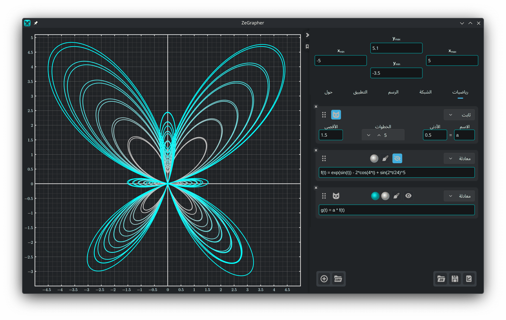

- [1. الرسم](#1-الرسم)
  - [1.1. التنقل والتكبير](#11-التنقل-والتكبير)
- [2. لوحة الإدخال](#2-لوحة-الإدخال)
  - [2.1. مجال العرض](#21-مجال-العرض)
  - [2.2. الملفات](#22-الملفات)
- [3. تبويب رياضيات](#3-تبويب-رياضيات)
  - [3.1. إضافة كائن](#31-إضافة-كائن)
  - [3.2. الدوال والمتتاليات](#32-الدوال-والمتتاليات)
  - [3.3. الثوابت](#33-الثوابت)
    - [3.3.1. التحريك](#331-التحريك)
    - [3.3.2. عدة قيم في آن واحد](#332-عدة-قيم-في-آن-واحد)
  - [3.4. المعادلات الوسيطية](#34-المعادلات-الوسيطية)
  - [3.5. البيانات](#35-البيانات)
    - [3.5.1. جدول البيانات](#351-جدول-البيانات)
    - [3.5.2. ملء عمود من كائن](#352-ملء-عمود-من-كائن)
    - [3.5.3. استيراد ملف CSV](#353-استيراد-ملف-csv)
  - [3.6. نمط الرسم](#36-نمط-الرسم)
- [4. تبويب الشبكة — التدريجات والشبكة](#4-تبويب-الشبكة--التدريجات-والشبكة)
- [5. تبويب الرسم — المظهر والدقة](#5-تبويب-الرسم--المظهر-والدقة)
- [6. تبويب التطبيق](#6-تبويب-التطبيق)
- [7. تبويب حول](#7-تبويب-حول)

## 1. الرسم

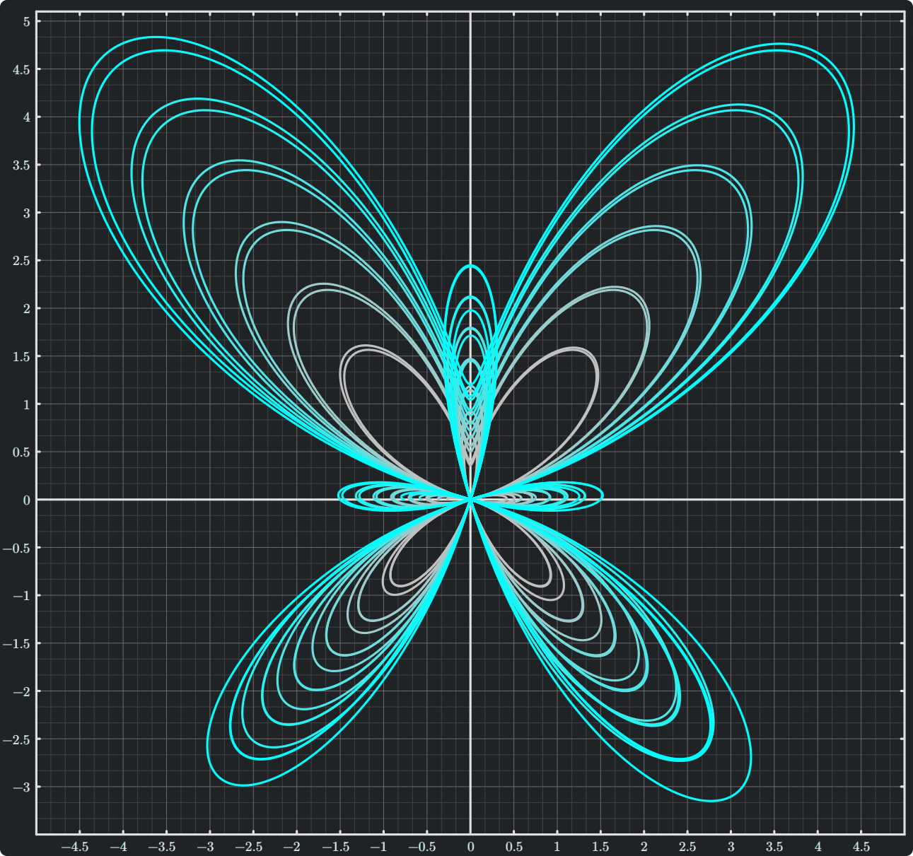

الرسم هو ما تراه على اليسار، وهو ما تصدّره. يحدد تبويبا
[الشبكة](#4-تبويب-الشبكة--التدريجات-والشبكة) و[الرسم](#5-تبويب-الرسم--المظهر-والدقة) مظهره ودقته وحجمه.

### 1.1. التنقل والتكبير

تتحكم في الرسم بالفأرة:

| الإجراء | الفأرة |
|--------|-------|
| تحريك العرض | السحب بالزر الأيسر |
| تكبير المحورين معًا | عجلة التمرير |
| تكبير المحور y وحده | `Ctrl` + تمرير عمودي |
| تكبير المحور x وحده | `Ctrl` + تمرير أفقي أو <br/> `Ctrl` + `Shift` + تمرير عمودي |

تبقى النقطة التي تحت المؤشر في مكانها أثناء التكبير.

على لوحة اللمس أو الشاشة اللمسية، يكبّر ضمّ الإصبعين المحورين معًا أيضًا.

على macOS، استعمل `Cmd` بدلًا من `Ctrl`.

## 2. لوحة الإدخال

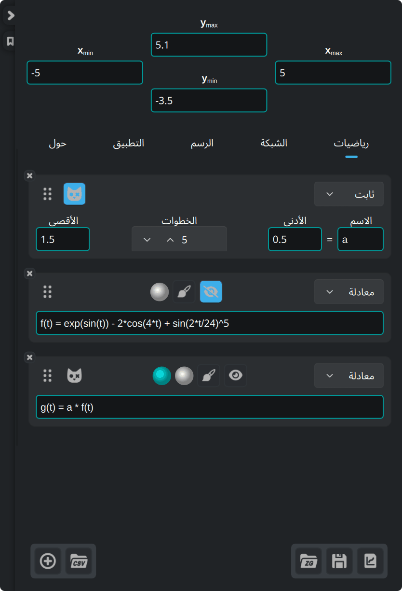

الحقول الأربعة في أعلى اللوحة هي حدود العرض. وتحتها خمسة تبويبات:

| التبويب | ما يحتويه |
|-----|---------------|
| **رياضيات** | الكائنات التي ترسمها: معادلات، ثوابت، معادلات وسيطية، بيانات |
| **الشبكة** | التدريجات والشبكة والشبكة الفرعية |
| **الرسم** | الحجم والخط والخلفية والمحاور |
| **التطبيق** | اللغة والخط وألوان العبارات والتحقق من التحديثات |
| **حول** | الإصدار والتحديثات والرخص وملاحظات الإصدارات |

الأزرار الثلاثة أسفل اللوحة على اليمين مخصصة [للملفات](#22-الملفات).

على حافة اللوحة:

- زر السهم يطوي اللوحة ويفتحها
- زر العلامة الذي تحته يفتح هذا الدليل ويغلقه
- اسحب الخط الممتد على الحافة اليسرى لتغيير عرض اللوحة

### 2.1. مجال العرض

تقبل الحقول الأربعة في أعلى اللوحة عبارات، لا أعدادًا فقط. يجب أن يبقى الحد
الأدنى أصغر من الحد الأقصى، وإلا صار الحقل غير صالح.

يعيد الزر المستدير في الزاوية العليا اليمنى المحورين إلى ‎-10 .. 10.

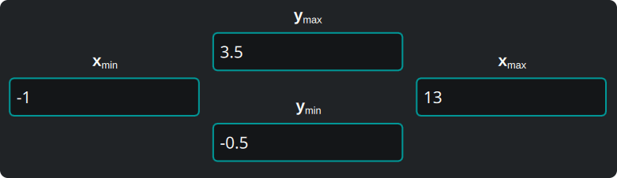

### 2.2. الملفات


الأزرار الثلاثة أسفل اللوحة على اليمين هي، بالترتيب من اليمين:

1. **تصدير الرسم** الذي تراه، بصيغة متجهية (`svg`، `pdf`) أو صورة (`png`،
   `jpeg`، `bmp`، `ppm`). يبدو الملف المصدَّر تمامًا كالرسم على الشاشة.
   الاختصار: `Ctrl` + `E`.
2. **حفظ** الكائنات والبيانات والعرض وإعدادات تبويبي الشبكة والرسم في مستند
   ZeGrapher (‎`.zg`‎). عند الحفظ أول مرة يُطلب منك اختيار ملف، ثم يُحفظ
   فيه في المرات التالية. لا تُحفظ إعدادات تبويب التطبيق في المستندات. الاختصارات: `Ctrl` + `S`، و`Ctrl`
   + `Shift` + `S` للحفظ في ملف آخر.
3. **تحميل** مستند من هذا النوع. يضيف التطبيق كائناته إلى الكائنات المفتوحة،
   ويأخذ العرض والإعدادات من المستند. الاختصار: `Ctrl` + `O`.

على macOS، تستعمل الاختصارات `Cmd` بدلًا من `Ctrl`.

إفلات مستند ‎`.zg`‎ على النافذة يحمّله كما يفعل زر **تحميل**، وإفلات ملف CSV
عليها يفتح [استيراد CSV](#353-استيراد-ملف-csv) في ورقة جديدة.

في التشغيل التالي، يفتح ZeGrapher آخر عمل لك من جديد. وإن مرّرت ملف ‎`.zg`‎ في
سطر الأوامر، فتح التطبيق ذلك الملف بدلًا منه.

## 3. تبويب رياضيات

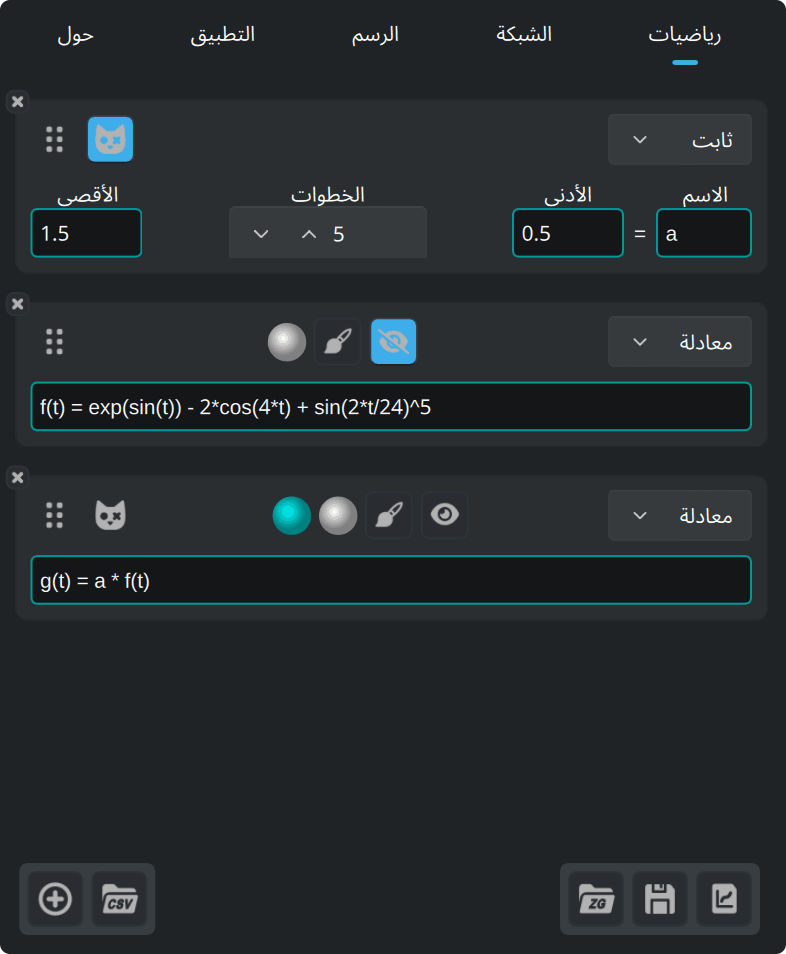

يعرّف هذا التبويب الكائنات التي تُرسم أو تُستعمل داخل كائنات أخرى: الدوال،
والمتتاليات، والثوابت (التي لا تُرسم أبدًا)، والمعادلات الوسيطية، وأعمدة
البيانات.

### 3.1. إضافة كائن

هذا الزر، في أسفل تبويب رياضيات، يضيف كائنًا.


اختر نوع الكائن من القائمة المنسدلة في أعلى البطاقة الجديدة.

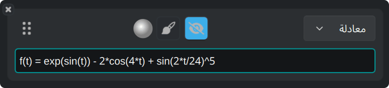

في كل بطاقة الأزرار نفسها:

- زر العين يُظهر المنحنى أو يخفيه.
- زر الفرشاة يفتح [نمط الرسم](#36-نمط-الرسم).
- القرص يبيّن لون المنحنى.
- اسحب المقبض على اليسار لتغيير ترتيب الكائنات.
- علامة **×** في الزاوية تحذف الكائن.

### 3.2. الدوال والمتتاليات

تُعرَّف الدالة بمعادلتها كما تكتبها على الورق:

```
f(x) = 2 + cos(x)
```

هذه الدوال مدمجة، ويمكن استعمالها في أي عبارة:

| النوع | الدوال |
|------|-----------|
| المثلثية | `cos`، `sin`، `tan`، `acos`، `asin`، `atan` |
| الزائدية | `cosh`، `sinh`، `tanh`، `acosh`، `asinh`، `atanh` |
| الزائدية، أسماء مختصرة | `ch`، `sh`، `th`، `ach`، `ash`، `ath` |
| القوى واللوغاريتمات | `sqrt`، `exp`، `ln` (الأساس e)، `log` (الأساس 10)، `lg` (الأساس 2) |
| التقريب | `floor`، `ceil` |
| بوسيطين | `max`، `min` |
| أخرى | `abs`، `erf`، `erfc`، `gamma` (وتُكتب أيضًا `Γ`) |

هذه الثوابت مدمجة:

| الاسم | القيمة |
|------|-------|
| `math::pi`، `math::π` | 3.141592653589793 |
| `physics::kB` | ثابت بولتزمان، 1.380649e-23 |
| `physics::h` | ثابت بلانك، 6.62607015e-34 |
| `physics::c` | سرعة الضوء في الفراغ، 299792458 |

قيم الثوابت الفيزيائية بوحدات النظام الدولي.

المتتالية (أو المتتابعة) قائمة عبارات تفصل بينها ‎`,`‎ أو ‎`;`‎. العبارات الأولى
هي الحدود الأولى للمتتالية. والعبارة **الأخيرة** هي الحد العام، ويستعملها
التطبيق لكل دليل بعد تلك الحدود الأولى.

```
u(n) = 0 ; 1 ; 0.5*(u(n-2) + u(n-1))
```

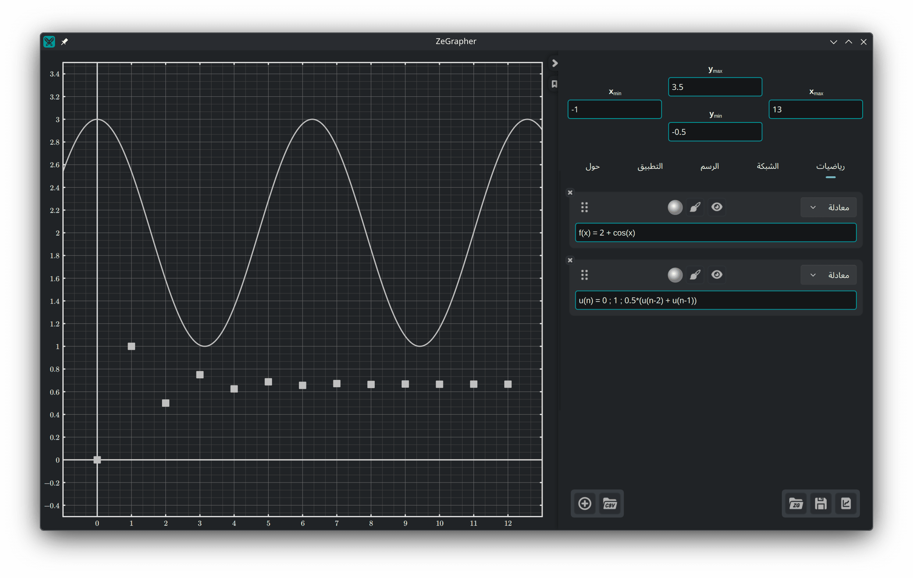

يبيّن لون إطار سطر الإدخال إن كانت العبارة صالحة. وتظهر تحت العبارة
غير الصالحة رسالة تذكر السبب.

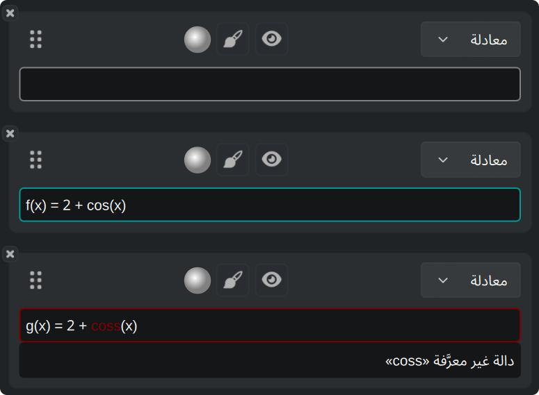

الحقل الذي ينتظر قيمة، مثل حد من حدود العرض، قد يأخذ لون التحذير: العبارة
صالحة، لكنها لا تعطي عددًا.

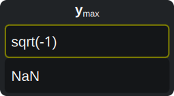

تختار هذه الألوان الثلاثة في [تبويب التطبيق](#6-تبويب-التطبيق).

### 3.3. الثوابت

**الثابت** اسم له قيمة عددية. يمكن لكل كائن آخر، ما عدا ثابتًا آخر، أن
يستعمله في عبارته.

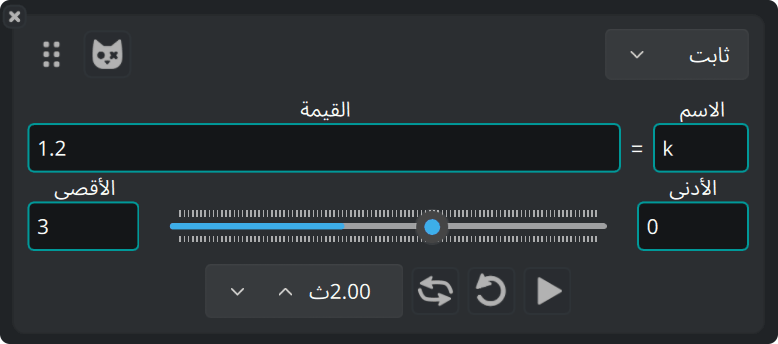

#### 3.3.1. التحريك

المنزلق الذي تحته يغيّر القيمة بين **الأدنى** و**الأقصى**، وتتغيّر معه كل
المنحنيات التي تستعمل الثابت. اسحب المنزلق يدويًا، أو شغّل التحريك التلقائي.
يضم الصف الذي تحت المنزلق أزرار التحريك: التشغيل، والتكرار، والذهاب والإياب،
ومدة المرور الواحد.

#### 3.3.2. عدة قيم في آن واحد

هذا الزر على بطاقة الثابت يحوّله إلى **ثابت شرودنغر**.


يأخذ الثابت عندئذ `steps + 1` قيمة، أي عدد **الخطوات** زائد واحد، متساوية
التباعد من الأدنى إلى الأقصى. ويرسم التطبيق كل كائن يستعمل الثابت مرة لكل
قيمة.

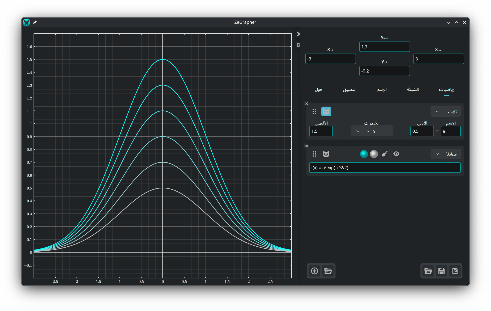

تحصل هذه الكائنات على قرص لون ثانٍ. ويرسم التطبيق عائلة المنحنيات بتدرّج من
اللون الأول إلى الثاني.

### 3.4. المعادلات الوسيطية

المعادلة الوسيطية زوج من الكائنات يعطي إحداثيات كل نقطة من المنحنى. اكتب
اسميهما في الحقلين:

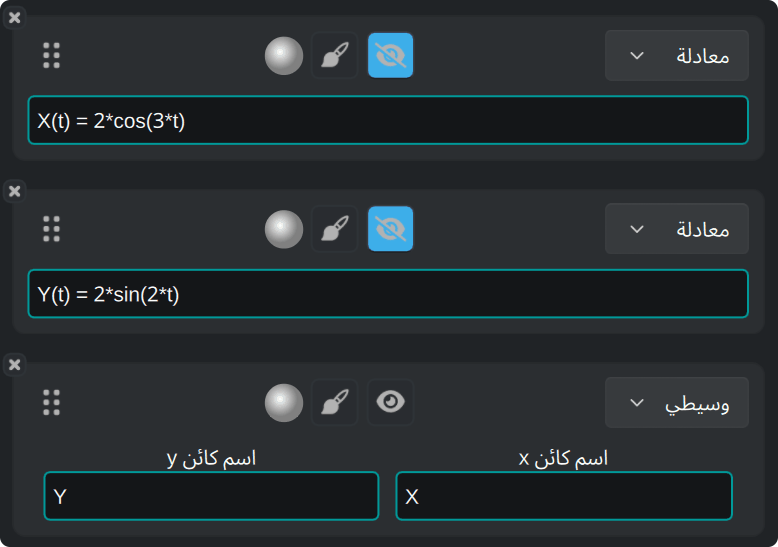

يرسم التطبيق الزوج بين **البداية** و**النهاية** المحددتين في
[نمط الرسم](#36-نمط-الرسم) للمعادلة الوسيطية.

### 3.5. البيانات

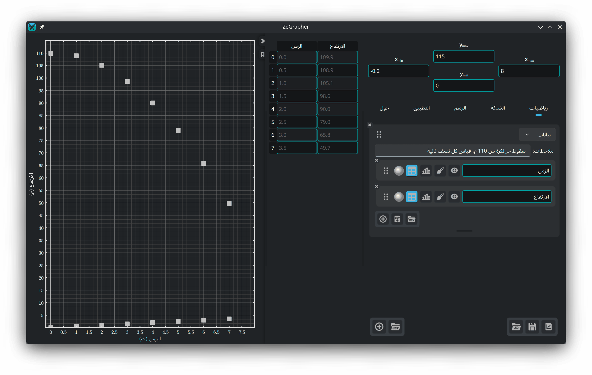

كائن البيانات ورقة من الأعمدة المسمّاة. كل عمود كائن رياضي مستقل، له اسم
والأزرار نفسها التي لأي كائن آخر.

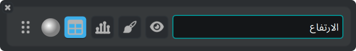

يرسم التطبيق قيم العمود بدلالة أدلتها: القيمة الأولى عند x = 0، والثانية عند
x = 1، وهكذا. لرسم عمود بدلالة عمود آخر، استعمل
[معادلة وسيطية](#34-المعادلات-الوسيطية).

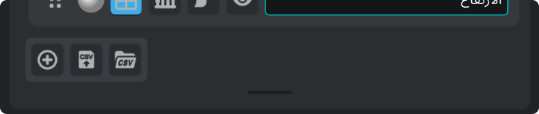

الأزرار أسفل الورقة على اليسار تستورد ملف CSV، وتصدّر الأعمدة إلى ملف CSV،
وتضيف عمودًا. اسحب الشريط الذي تحتها لتغيير حجم الورقة، وانقر عليه نقرًا
مزدوجًا لإعادة الورقة إلى ارتفاعها الافتراضي.

#### 3.5.1. جدول البيانات

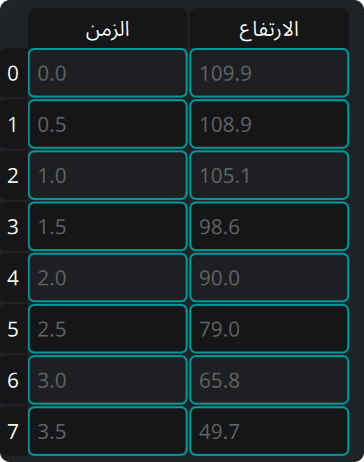

زر **الجدول** على العمود يُظهر ذلك العمود في الجدول بجانب اللوحة. يبقى الجدول
من اليسار إلى اليمين، بترتيب أعمدة ملف CSV. في الجدول:

- انقر على خلية ثم اكتب لتعديلها، أو اضغط `Enter` لفتح المحرر.
- انقر على عنوان لتحديد صف كامل أو عمود كامل.
- انقر واسحب لتحديد مستطيل من الخلايا.
- اضغط `Backspace` لمسح محتوى الخلايا المحددة.
- اضغط `Delete` لحذف الخلايا المحددة. تصعد القيم التي تحتها.
- قائمة النقر بالزر الأيمن تضم هذين الإجراءين نفسيهما، باسم *مسح* و*حذف*،
  وتضيف *إدراج صف فوقه* و*إدراج صف تحته*. يعمل خيارا الإدراج على الخلية
  النشطة.

تحديد عمود كامل ثم الضغط على `Delete` يحذف أيضًا كائن العمود في تبويب
رياضيات.

#### 3.5.2. ملء عمود من كائن

زر المخطط الشريطي على العمود يفتح نموذجًا صغيرًا: اكتب اسم كائن، وأعطِ
**البداية** و**النهاية** و**الخطوة**. زر التأشير يأخذ عينات من الكائن ويضع
القيم في العمود.

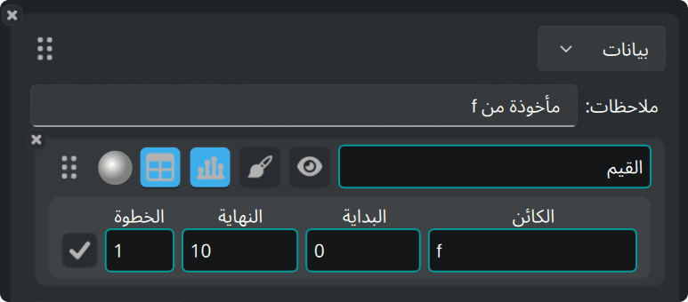

#### 3.5.3. استيراد ملف CSV

زر CSV موجود على الورقة، وفي أسفل تبويب رياضيات لورقة جديدة.

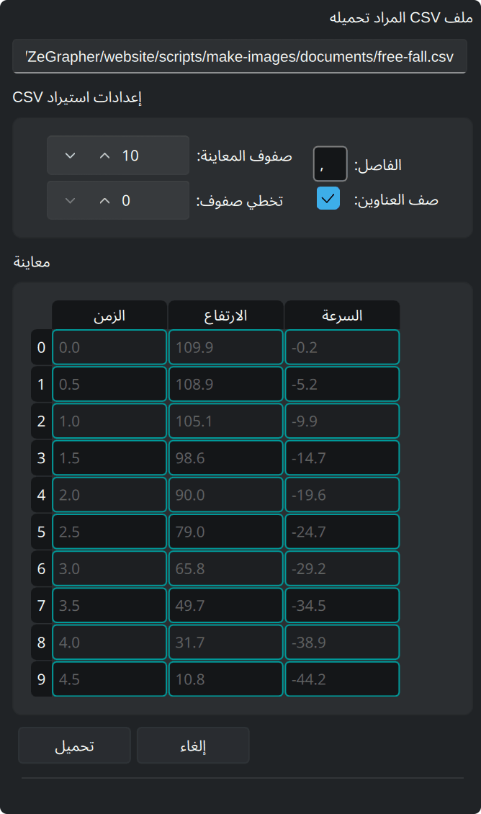

يفتح الزر نافذة لاختيار الملف. ثم تُظهر لوحة جانبية إعدادات الاستيراد، وتحتها
معاينة للملف. تتحدّث المعاينة كلما غيّرت إعدادًا:

- **الفاصل** — المحرف بين قيمتين. اكتب ‎`\t`‎ لمسافة الجدولة `TAB`.
- **صف العناوين** — فعّله إن كان الصف الأول يحتوي أسماء الأعمدة.
- **صفوف المعاينة** — عدد الصفوف التي تُظهرها المعاينة.
- **تخطي صفوف** — عدد الصفوف التي تُتجاهل في أعلى الملف، مثل التعليقات أو
  المعاملات الإضافية.

**تحميل** ينشئ أعمدة من الملف، و**إلغاء** يترك كل شيء كما كان.

جرّبنا ZeGrapher على ملفات CSV من عدة ملايين من الخلايا.

### 3.6. نمط الرسم

زر الفرشاة يفتح نمط رسم الكائن:

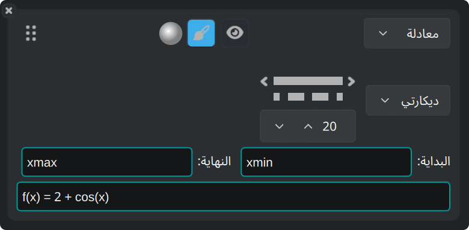

- إحداثيات **ديكارتي** أو **قطبي**.
- نقش الخط — متصل، أو متقطع، أو شَرطة ونقطة، أو منقّط، أو بلا خط — وسُمكه.
- للكائنات المرسومة نقاطًا (المتتاليات والبيانات)، شكل النقطة وحجمها.
- **البداية** و**النهاية**: المجال الذي يرسم عليه التطبيق الكائن. القيمتان
  الافتراضيتان هما `xmin` و`xmax`، حدّا العرض. يقبل الحقلان أي عبارة، مثل
  ‎`-math::pi`‎ و`4*math::pi`.

## 4. تبويب الشبكة — التدريجات والشبكة

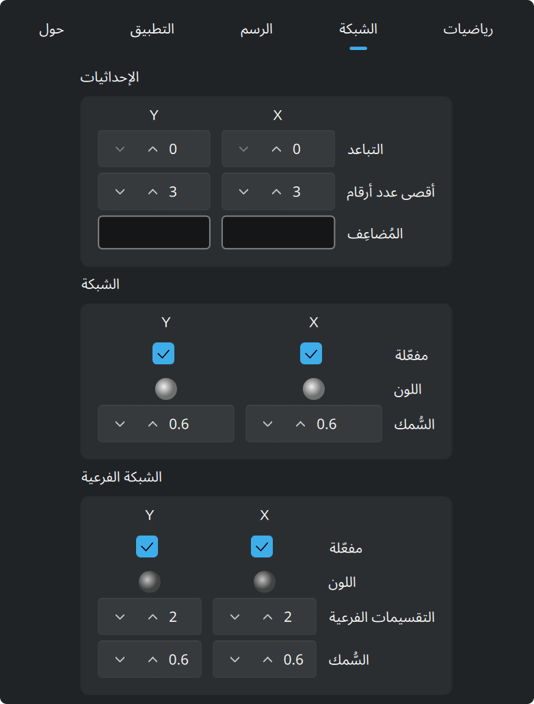

يضبط قسم **الإحداثيات** الأعداد على امتداد المحاور: تباعدها، وعدد الأرقام التي
يمكن أن تستعملها، و**المُضاعِف**. المُضاعِف عبارة، فيمكن أن تكون التدريجات
مضاعفات لـ `math::pi`، وتُكتب تسمياتها مضاعفاتٍ له.

تضبط **الشبكة** و**الشبكة الفرعية** لكل من x وy على حدة. لكل منهما لون، وسُمك
خط، ومفتاح يُظهرها أو يخفيها. وتحدد للشبكة الفرعية أيضًا عدد الأجزاء التي
تُقسم إليها كل خلية.

## 5. تبويب الرسم — المظهر والدقة

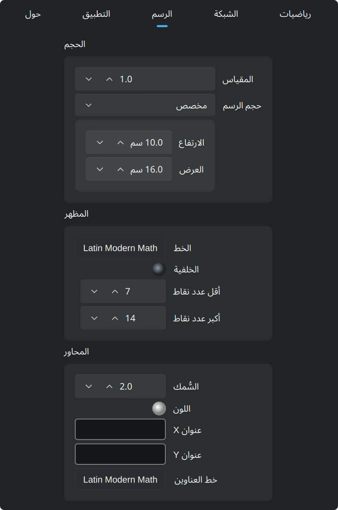

يملأ الرسم النافذة افتراضيًا. اضبط **حجم الرسم** على *مخصص*، في إطار **الحجم**
في الأعلى، فيصير الرسم ورقة بالحجم الذي تحدده. هذا الحجم
**بالسنتيمترات الحقيقية**. السنتيمتر سنتيمتر حقيقي على الشاشة، ويبقى كذلك في
ملف `pdf` أو `svg` مصدَّر.

**المقياس**، في الإطار نفسه، يغيّر حجم كل ما يرسمه التطبيق دفعة واحدة: الخطوط
والنصوص والتدريجات.

يرسم التطبيق تلك الورقة صفحةً داخل النافذة، وفوقها شريط تكبير:


يكبّر الشريط الورقة على الشاشة، ويضبط الزر الأخير الورقة كلها على قياس النافذة. لا
يغيّر هذا التكبير الرسم: تبقى حدود العرض كما هي. أحجام السنتيمترات صحيحة عند
تكبير 100%.

الإطاران تحت **الحجم**:

- **المظهر**: خط الرسم ولون خلفيته. يحدد **أقل عدد نقاط** و**أكبر عدد نقاط**
  عدد النقاط التي يحسبها التطبيق لكل منحنى متصل، كقوة للعدد 2. المزيد من
  النقاط يعطي منحنى أدق وإعادة رسم أبطأ.
- **المحاور**: سُمك الخط، واللون، والعنوانان المكتوبان على امتداد x وy، والخط
  الذي يستعملانه.

## 6. تبويب التطبيق

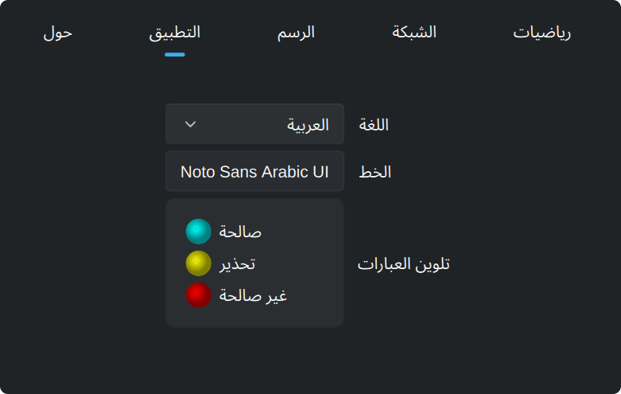

يضبط هذا التبويب لغة الواجهة وخطها، والألوان الثلاثة لأسطر الإدخال: صالحة،
وتحذير، وغير صالحة.

يسأل **التحقق عند البدء**، تحت **التحديثات**، موقع zegrapher.com عن أحدث إصدار
عند كل تشغيل للتطبيق. إذا صدر إصدار أحدث، يظهر فوق الرسم شريط فيه رابط إلى
الموقع. يرسل التحقق إصدار التطبيق ولغته، ونظام التشغيل، وبنية المعالج. ويرى
الموقع أيضًا عنوان IP، ولا يستعمله إلا لمعرفة البلد. قد تخلو حزم توزيعات لينكس
من هذا الإعداد، لأن مدير الحزم يتولى التحديثات.

## 7. تبويب حول

يعرّف هذا التبويب بـ ZeGrapher. ويضم:

- الإصدار الذي تشغّله، وزرًا يسأل zegrapher.com إن صدر إصدار أحدث
- روابط إلى الموقع وإلى الشيفرة المصدرية وإلى المؤلف
- رخص ZeGrapher وQt والخط الرياضي المرفق
- زر **تبرّع** الذي يفتح صفحة التبرع
- ملاحظات الإصدارات: جديد كل إصدار، مع رابط إلى صفحته على GitHub
