# Handbuch

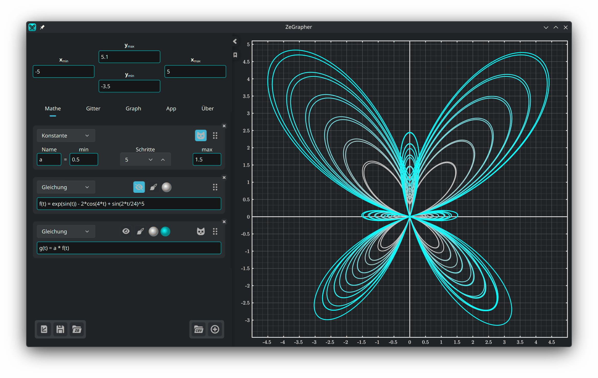

- [1. Der Graph](#1-der-graph)
  - [1.1. Verschieben und zoomen](#11-verschieben-und-zoomen)
- [2. Die Eingabeleiste](#2-die-eingabeleiste)
  - [2.1. Grenzen der Ansicht](#21-grenzen-der-ansicht)
  - [2.2. Dateien](#22-dateien)
- [3. Der Reiter Mathe](#3-der-reiter-mathe)
  - [3.1. Ein Objekt hinzufügen](#31-ein-objekt-hinzufügen)
  - [3.2. Funktionen und Folgen](#32-funktionen-und-folgen)
  - [3.3. Konstanten](#33-konstanten)
    - [3.3.1. Animation](#331-animation)
    - [3.3.2. Mehrere Werte auf einmal](#332-mehrere-werte-auf-einmal)
  - [3.4. Parameterdarstellungen](#34-parameterdarstellungen)
  - [3.5. Daten](#35-daten)
    - [3.5.1. Die Datentabelle](#351-die-datentabelle)
    - [3.5.2. Eine Spalte aus einem Objekt füllen](#352-eine-spalte-aus-einem-objekt-füllen)
    - [3.5.3. Eine CSV-Datei laden](#353-eine-csv-datei-laden)
  - [3.6. Kurvenstil](#36-kurvenstil)
- [4. Der Reiter Gitter — Teilstriche und Gitter](#4-der-reiter-gitter--teilstriche-und-gitter)
- [5. Der Reiter Graph — Aussehen und Genauigkeit](#5-der-reiter-graph--aussehen-und-genauigkeit)
- [6. Der Reiter App](#6-der-reiter-app)
- [7. Der Reiter Über](#7-der-reiter-über)

## 1. Der Graph

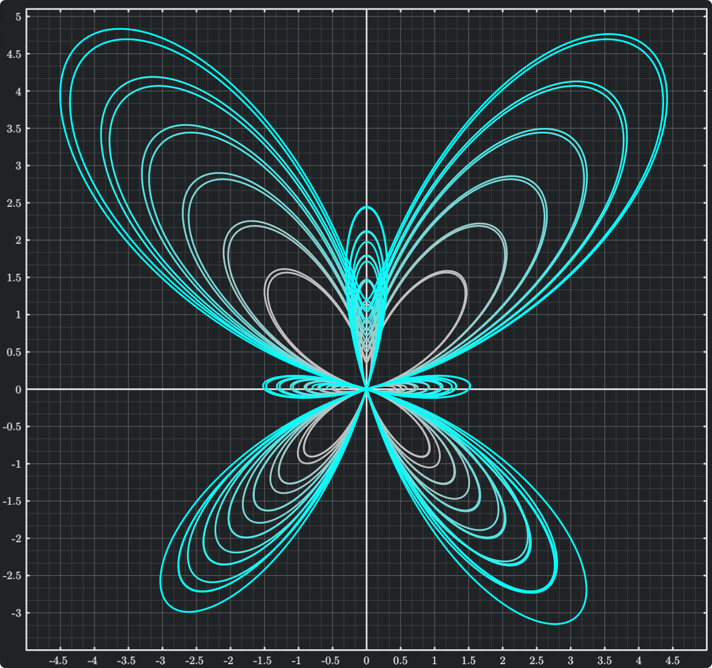

Der Graph ist das, was du rechts siehst und exportierst. Die Reiter
[Gitter](#4-der-reiter-gitter--teilstriche-und-gitter) und
[Graph](#5-der-reiter-graph--aussehen-und-genauigkeit) bestimmen sein Aussehen,
seine Genauigkeit und seine Größe.

### 1.1. Verschieben und zoomen

Den Graphen steuerst du mit der Maus:

| Aktion | Maus |
|--------|------|
| Ansicht verschieben | Mit gedrückter linker Maustaste ziehen |
| Beide Achsen gleichzeitig zoomen | Mausrad |
| Nur die y-Achse zoomen | `Strg` + vertikal scrollen |
| Nur die x-Achse zoomen | `Strg` + horizontal scrollen oder <br/> `Strg` + `Umschalt` + vertikal scrollen |

Beim Zoomen bleibt der Punkt unter dem Mauszeiger an seiner Position.

Auf einem Touchpad oder Touchscreen kannst du beide Achsen auch mit einer
Zwei-Finger-Geste zoomen.

## 2. Die Eingabeleiste

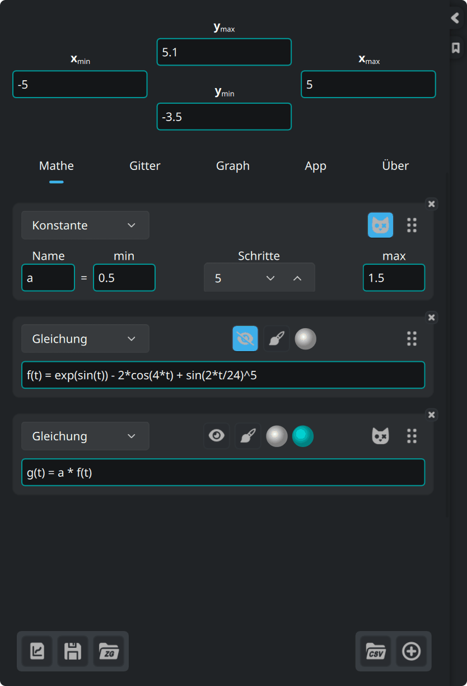

Die vier Felder oben in der Leiste legen die Grenzen der Ansicht fest. Darunter
befinden sich fünf Reiter:

| Reiter | Inhalt |
|--------|--------|
| **Mathe** | Die gezeichneten Objekte: Gleichungen, Konstanten, Parameterdarstellungen und Daten |
| **Gitter** | Teilstriche, Gitter und Untergitter |
| **Graph** | Größe, Schrift, Hintergrund und Achsen |
| **App** | Sprache, Schrift und Syntaxfarben |
| **Über** | Version, Updates, Lizenzen und Versionshinweise |

Die drei Knöpfe unten links dienen zur Arbeit mit [Dateien](#22-dateien).

Am Rand der Leiste kannst du:

- mit dem Pfeilknopf die Leiste ein- und ausklappen
- mit dem Lesezeichenknopf darunter dieses Handbuch öffnen und schließen
- die Linie am rechten Rand ziehen, um die Breite der Leiste anzupassen

### 2.1. Grenzen der Ansicht

Die vier Felder oben in der Leiste akzeptieren nicht nur Zahlen, sondern auch
mathematische Ausdrücke. Ein Minimum muss kleiner als das zugehörige Maximum
bleiben. Andernfalls wird das Feld als ungültig markiert.

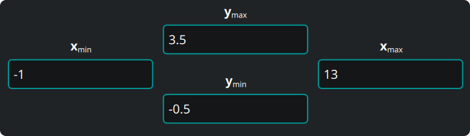

### 2.2. Dateien

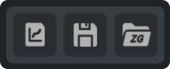

Die drei Knöpfe unten links in der Leiste haben der Reihe nach diese Funktionen:

1. Den sichtbaren Graphen **exportieren**, als Vektorgrafik (`svg`, `pdf`) oder
   als Bild (`png`, `jpeg`, `bmp`, `ppm`). Der Export entspricht genau dem
   Graphen auf dem Bildschirm. Tastenkürzel: `Strg` + `E`.
2. Die Objekte, Daten, Ansicht und Einstellungen der Reiter Gitter und Graph
   als ZeGrapher-Dokument (`.zg`) **speichern**. Beim ersten Speichern wirst du
   nach einer Datei gefragt. Danach wird in dieselbe Datei gespeichert. Die
   Einstellungen des Reiters App werden nicht im Dokument gespeichert.
   Tastenkürzel: `Strg` + `S` und `Strg` + `Umschalt` + `S`, um in einer anderen
   Datei zu speichern.
3. Ein solches Dokument **laden**. Das Programm fügt dessen Objekte zu den
   bereits geöffneten hinzu und übernimmt die Ansicht und Einstellungen aus
   dem Dokument. Tastenkürzel: `Strg` + `O`.

Unter macOS verwendest du bei den Tastenkürzeln `Cmd` statt `Strg`.

Ziehst du ein `.zg`-Dokument auf das Fenster, wird es wie über **Laden**
geöffnet. Ziehst du eine CSV-Datei darauf, öffnet sich der
[CSV-Import](#353-eine-csv-datei-laden) für ein neues Datenblatt.

Beim nächsten Start stellt ZeGrapher deine letzte Arbeit wieder her. Übergibst
du beim Programmstart eine `.zg`-Datei über die Kommandozeile, wird stattdessen
diese Datei geöffnet.

## 3. Der Reiter Mathe

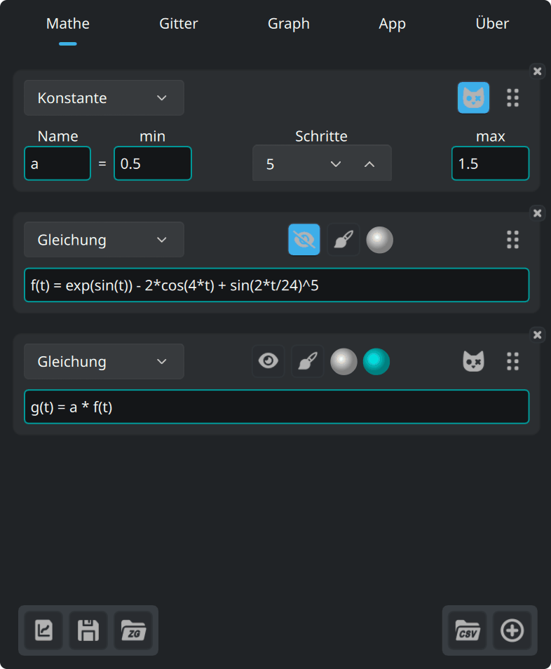

Hier legst du die Objekte fest, die gezeichnet oder in anderen Objekten
verwendet werden: Funktionen, Folgen, Konstanten (die selbst nie gezeichnet
werden), Parameterdarstellungen und Datenspalten.

### 3.1. Ein Objekt hinzufügen

Mit diesem Knopf unten im Reiter Mathe fügst du ein Objekt hinzu.


Im Dropdown-Menü oben auf der neuen Objektkarte wählst du die Art des Objekts.

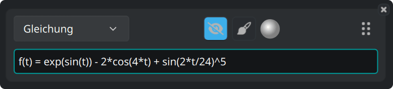

Jede Objektkarte hat dieselben Bedienelemente:

- Mit dem Augenknopf blendest du die Kurve ein oder aus.
- Der Pinselknopf öffnet den [Kurvenstil](#36-kurvenstil).
- Die Farbscheibe zeigt die Farbe der Kurve.
- Zieh den Griff rechts, um die Reihenfolge der Objekte zu ändern.
- Mit dem **×** in der Ecke löschst du das Objekt.

### 3.2. Funktionen und Folgen

Eine Funktion definierst du durch ihre Gleichung, wie auf Papier:

```
f(x) = 2 + cos(x)
```

Die folgenden Funktionen sind bereits eingebaut und können in jedem Ausdruck
verwendet werden:

| Art | Funktionen |
|-----|------------|
| Trigonometrie | `cos`, `sin`, `tan`, `acos`, `asin`, `atan` |
| Hyperbolische Funktionen | `cosh`, `sinh`, `tanh`, `acosh`, `asinh`, `atanh` |
| Hyperbolische Funktionen, Kurzformen | `ch`, `sh`, `th`, `ach`, `ash`, `ath` |
| Potenzen und Logarithmen | `sqrt`, `exp`, `ln` (Basis e), `log` (Basis 10), `lg` (Basis 2) |
| Rundung | `floor`, `ceil` |
| Zwei Argumente | `max`, `min` |
| Weitere | `abs`, `erf`, `erfc`, `gamma` (auch `Γ`) |

Diese Konstanten sind bereits eingebaut:

| Name | Wert |
|------|------|
| `math::pi`, `math::π` | 3.141592653589793 |
| `physics::kB` | die Boltzmann-Konstante, 1.380649e-23 |
| `physics::h` | die Planck-Konstante, 6.62607015e-34 |
| `physics::c` | die Lichtgeschwindigkeit im Vakuum, 299792458 |

Die drei physikalischen Konstanten verwenden SI-Einheiten.

Eine Folge besteht aus Ausdrücken, die durch `,` oder `;` getrennt sind. Die
ersten Ausdrücke geben die Anfangsglieder an. Der **letzte** Ausdruck ist das
allgemeine Glied, das für alle nachfolgenden Indizes verwendet wird.

```
u(n) = 0 ; 1 ; 0.5*(u(n-2) + u(n-1))
```

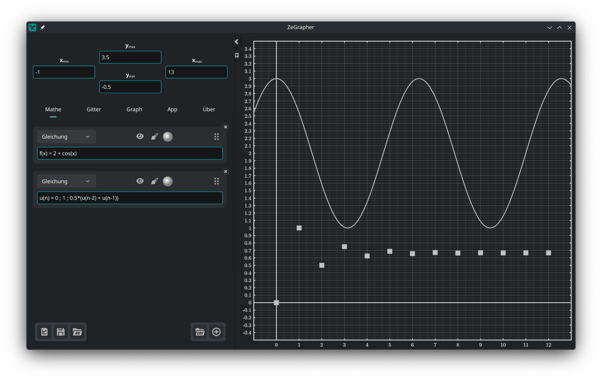

Die Rahmenfarbe einer Eingabezeile zeigt an, ob der Ausdruck gültig ist. Bei
einem ungültigen Ausdruck erscheint darunter zusätzlich eine Fehlermeldung
mit dem Grund.

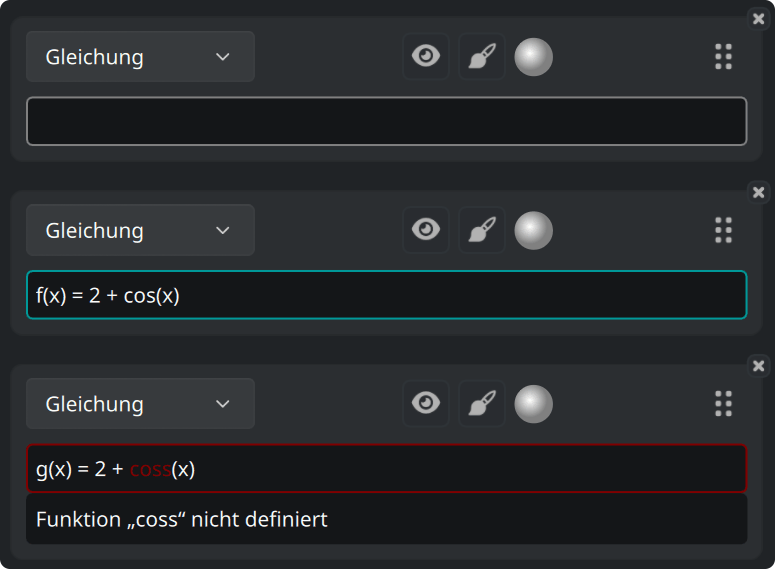

Ein Feld, das einen Wert erwartet, etwa eine Grenze der Ansicht, kann auch die
Warnfarbe annehmen: Der Ausdruck ist dann gültig, liefert aber keine Zahl.

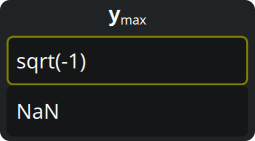

Diese drei Farben kannst du im [Reiter App](#6-der-reiter-app) einstellen.

### 3.3. Konstanten

Eine **Konstante** besteht aus einem Namen und einem Zahlenwert. Alle anderen
Objekte außer weiteren Konstanten können sie in ihren Ausdrücken verwenden.

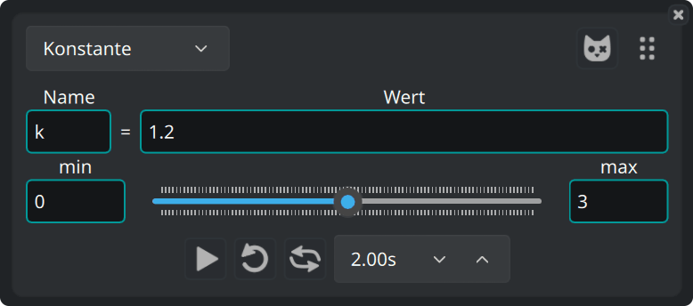

#### 3.3.1. Animation

Mit dem Schieberegler darunter veränderst du den Wert zwischen **min** und
**max**. Alle Kurven, die diese Konstante verwenden, passen sich entsprechend
an. Du kannst den Regler von Hand bewegen oder animieren. Unter dem Regler
befinden sich die Steuerelemente für die Animation: Wiedergabe, Schleife,
Hin-und-her-Bewegung und Dauer eines Durchlaufs.

#### 3.3.2. Mehrere Werte auf einmal

Mit diesem Knopf auf einer Konstantenkarte machst du die Konstante zu einer
**Schrödinger-Konstante**.


Die Konstante nimmt dann `Schritte + 1` gleichmäßig zwischen min und max verteilte
Werte an. Das Programm zeichnet jedes Objekt, das diese Konstante verwendet,
einmal für jeden Wert.

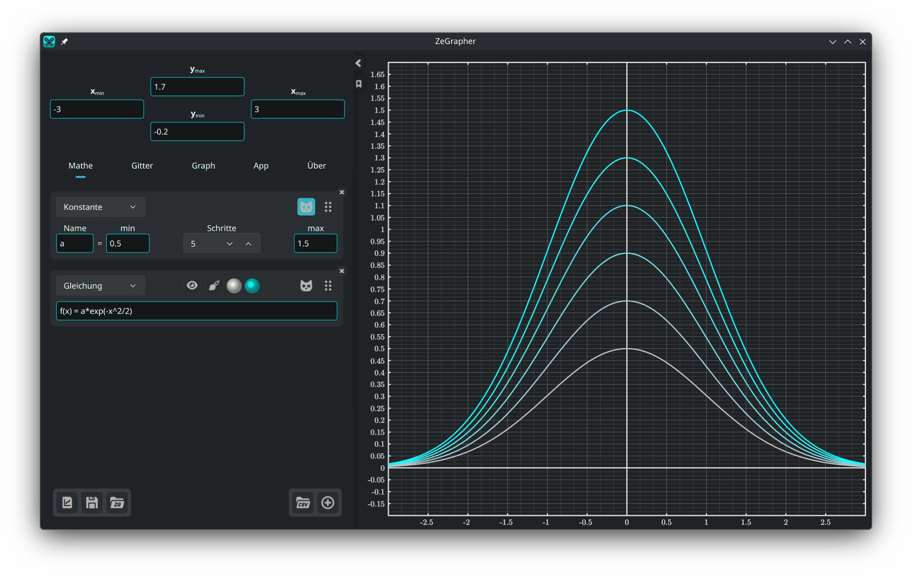

Diese Objekte erhalten eine zweite Farbscheibe. Das Programm zeichnet die
Kurvenschar mit einem Farbverlauf von der ersten zur zweiten Farbe.

### 3.4. Parameterdarstellungen

Eine Parameterdarstellung besteht aus zwei Objekten, die die Koordinaten jedes
Punktes einer Kurve angeben. Ihre Namen trägst du in die beiden Felder ein:

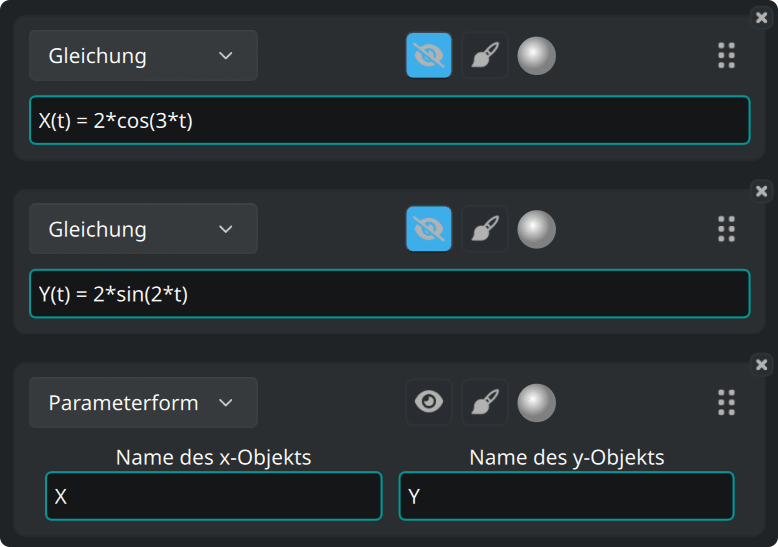

Das Programm zeichnet die Parameterkurve von **Anfang** bis **Ende**. Diese
Werte legst du im [Kurvenstil](#36-kurvenstil) der Parameterdarstellung fest.

### 3.5. Daten

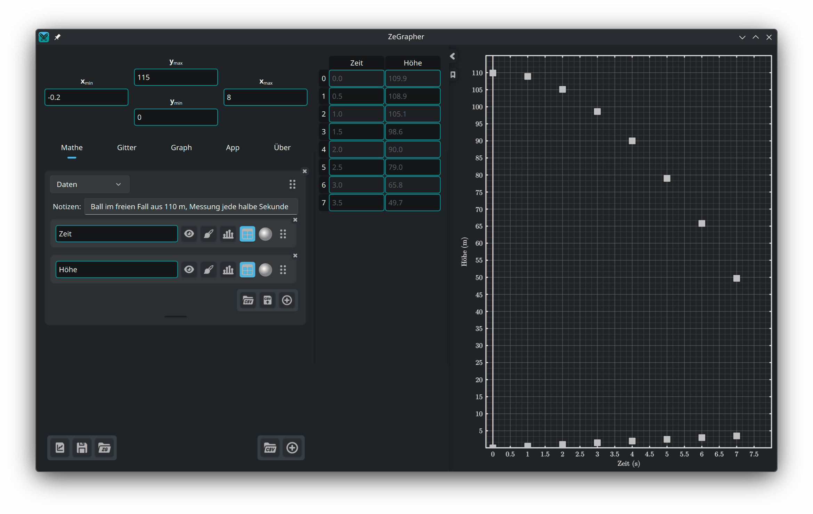

Ein Datenobjekt ist ein Blatt mit benannten Spalten. Jede Spalte ist selbst ein
mathematisches Objekt mit einem Namen und denselben Knöpfen wie andere Objekte.

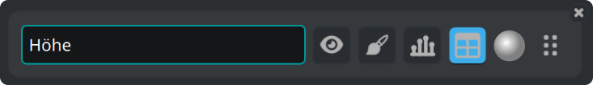

Das Programm zeichnet die Werte einer Spalte gegen ihre Indizes: den ersten
Wert bei x = 0, den zweiten bei x = 1 und so weiter. Um die Werte einer Spalte
gegen die einer anderen darzustellen, verwendest du eine
[Parameterdarstellung](#34-parameterdarstellungen).

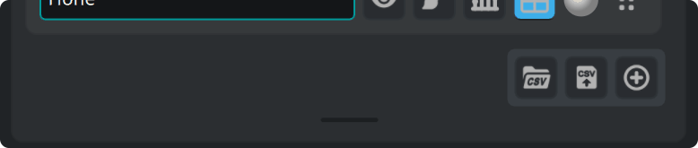

Mit den Knöpfen unten rechts am Datenblatt kannst du eine CSV-Datei importieren,
die Spalten in eine CSV-Datei exportieren oder eine neue Spalte hinzufügen.
Zieh den Balken darunter, um die Höhe des Datenblatts zu ändern. Mit einem
Doppelklick auf den Balken stellst du die Standardhöhe wieder her.

#### 3.5.1. Die Datentabelle

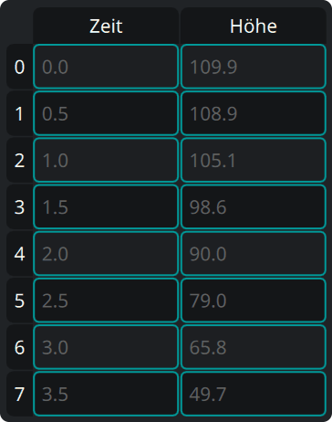

Der **Tabellenknopf** einer Spalte zeigt diese in der Tabelle neben der
Eingabeleiste an. In der Tabelle kannst du:

- eine Zelle anklicken und direkt bearbeiten oder mit `Eingabe` den Editor öffnen
- eine Zeilen- oder Spaltenüberschrift anklicken, um die ganze Zeile oder Spalte
  auszuwählen
- mit gedrückter Maustaste einen rechteckigen Zellbereich auswählen
- mit `Rücktaste` den Inhalt der ausgewählten Zellen leeren
- mit `Entf` die ausgewählten Zellen entfernen; die Werte darunter rücken nach
  oben
- über das Kontextmenü mit der rechten Maustaste dieselben Aktionen unter
  *Leeren* und *Löschen* ausführen oder mit *Zeile darüber einfügen* und
  *Zeile darunter einfügen* neue Zeilen hinzufügen; beide Einfügeaktionen
  beziehen sich auf die aktive Zelle

Wenn du eine ganze Spalte auswählst und `Entf` drückst, wird auch das
entsprechende Spaltenobjekt im Reiter Mathe gelöscht.

#### 3.5.2. Eine Spalte aus einem Objekt füllen

Der Knopf mit dem Balkendiagramm öffnet ein kleines Formular. Dort gibst du
den Namen eines Objekts sowie **Anfang**, **Ende** und **Schritt** an. Mit dem
Häkchenknopf werden die Werte des Objekts berechnet und in die Spalte geladen.

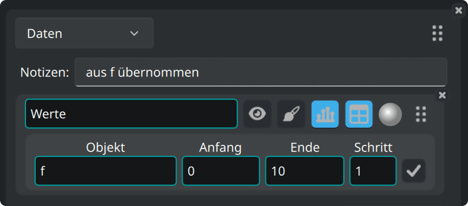

#### 3.5.3. Eine CSV-Datei laden

Den CSV-Knopf findest du auf einem Datenblatt oder unten im Reiter Mathe, wenn
du ein neues Blatt anlegen möchtest.

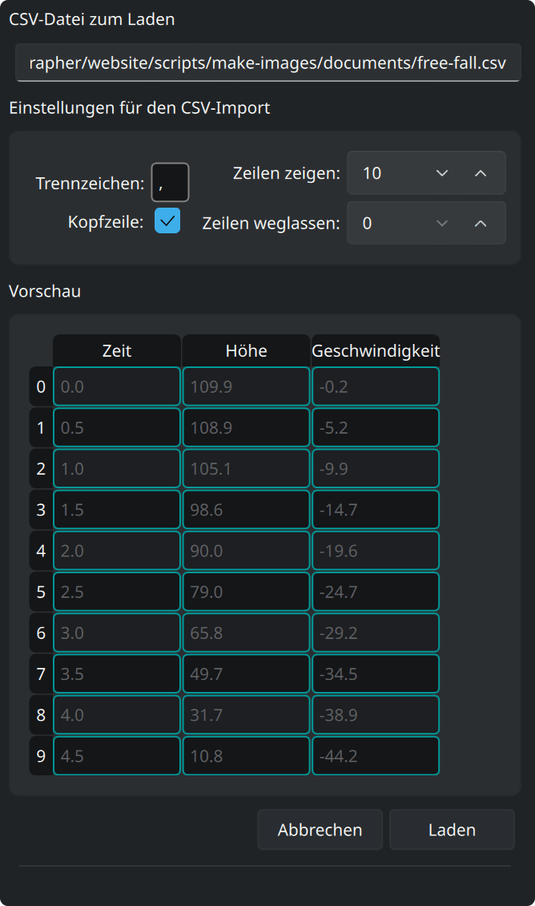

Er öffnet einen Dateidialog. Anschließend erscheint seitlich ein Bereich mit
den Importeinstellungen und darunter eine Vorschau der Datei. Die Vorschau
aktualisiert sich, sobald du eine Einstellung änderst:

- **Trennzeichen** — das Zeichen zwischen zwei Werten. Für einen Tabulator
  gibst du `\t` ein.
- **Kopfzeile** — aktiviere diese Option, wenn die erste Zeile die Spaltennamen
  enthält.
- **Vorschauzeilen** — legt fest, wie viele Zeilen in der Vorschau erscheinen.
- **Zeilen überspringen** — legt fest, wie viele Zeilen am Anfang der Datei
  ignoriert werden, zum Beispiel Kommentare oder zusätzliche Parameter.

Mit **Laden** werden die Daten aus der Datei in Spalten übernommen. Mit
**Abbrechen** bleibt alles unverändert.

Wir haben ZeGrapher mit CSV-Dateien getestet, die mehrere Millionen Zellen
enthalten.

### 3.6. Kurvenstil

Der Pinselknopf öffnet die Einstellungen, die bestimmen, wie ein Objekt
gezeichnet wird:

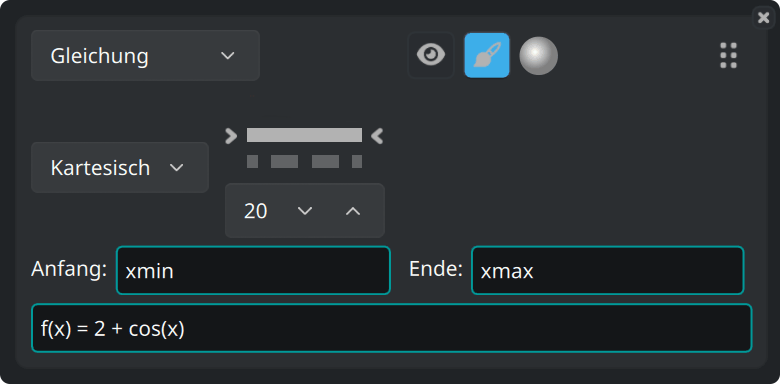

- **Kartesische** oder **polare** Koordinaten.
- Linienart — durchgezogen, gestrichelt, Strich-Punkt, gepunktet oder ohne
  Linie — und Linienstärke.
- Bei Objekten, die als Punkte gezeichnet werden (Folgen und Daten), die Form
  und Größe der Punkte.
- **Anfang** und **Ende**: der Bereich, über den das Objekt gezeichnet wird.
  Standardmäßig sind `xmin` und `xmax` eingestellt, also die Grenzen der
  Ansicht. Beide Felder akzeptieren beliebige Ausdrücke, zum Beispiel
  `-math::pi` und `4*math::pi`.

## 4. Der Reiter Gitter — Teilstriche und Gitter

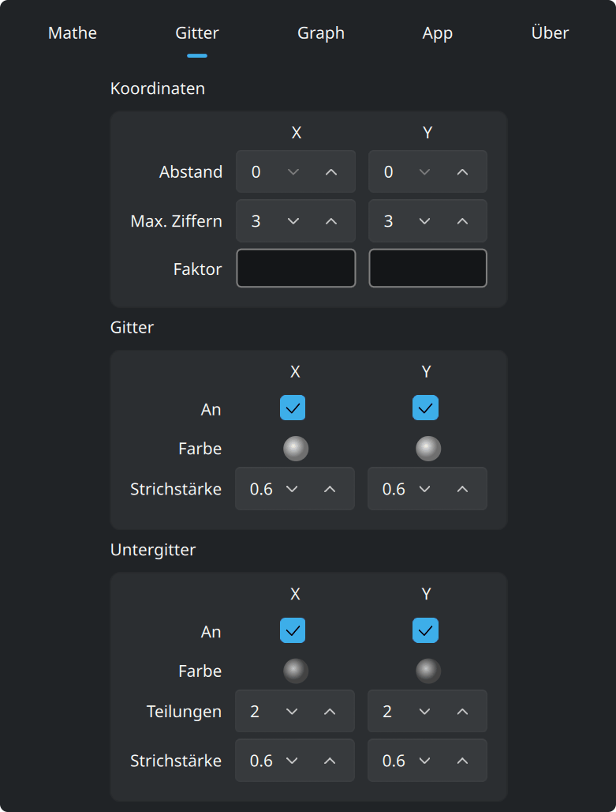

Unter **Koordinaten** legst du die Zahlen entlang der Achsen fest: ihren
Abstand, die maximal verwendete Anzahl an Ziffern und einen **Faktor**. Der
Faktor ist ein mathematischer Ausdruck. So können Teilstriche Vielfache von
`math::pi` sein, und die Beschriftungen werden ebenfalls als Vielfache davon
angezeigt.

**Gitter** und **Untergitter** stellst du für die x- und y-Achse getrennt ein.
Für beide lassen sich Farbe, Linienstärke und Sichtbarkeit festlegen. Beim
Untergitter bestimmst du zusätzlich, in wie viele Teile jede Gitterzelle
unterteilt wird.

## 5. Der Reiter Graph — Aussehen und Genauigkeit

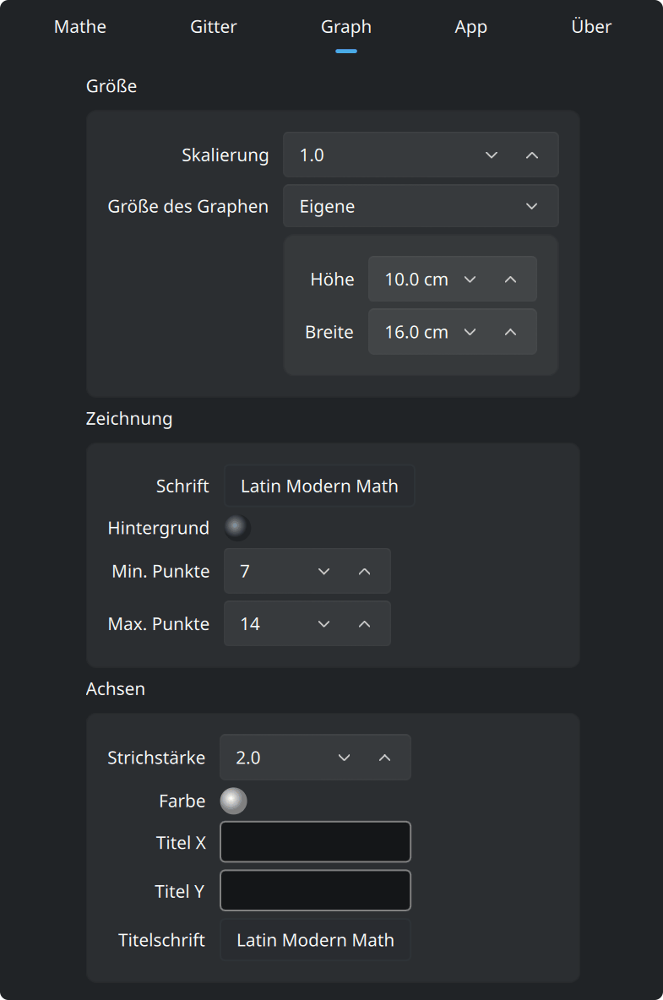

Standardmäßig füllt der Graph das Fenster. Stellst du im oberen Bereich
**Größe** die Option **Größe des Graphen** auf *Eigene*, wird der Graph als
Blatt in der von dir festgelegten Größe dargestellt. Diese Größe wird in
**realen Zentimetern** angegeben. Ein Zentimeter entspricht auf dem
Bildschirm einem realen Zentimeter und behält diese Größe auch in einer
exportierten `pdf`- oder `svg`-Datei.

Mit **Skalierung** im selben Bereich kannst du alles, was das Programm
zeichnet, gleichzeitig vergrößern oder verkleinern: Linien, Text und
Teilstriche.

Das Programm zeigt das Blatt als Seite im Fenster an, mit einer Zoomleiste
darüber:

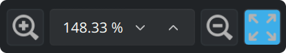

Mit der Leiste zoomst du das Blatt auf dem Bildschirm. Der letzte Knopf passt
das gesamte Blatt an die Fenstergröße an. Dieser Zoom verändert den Graphen
selbst nicht: Die Grenzen der Ansicht bleiben unverändert. Die Größen in
Zentimetern stimmen bei 100 % Zoom.

Unter **Größe** befinden sich zwei weitere Bereiche:

- **Zeichnung**: Schriftart und Hintergrundfarbe des Graphen. **Min. Punkte**
  und **Max. Punkte** legen fest, wie viele Punkte das Programm für jede
  kontinuierliche Kurve berechnet, jeweils als Zweierpotenz. Mehr Punkte
  ergeben eine feinere Kurve, verlangsamen aber das Neuzeichnen.
- **Achsen**: Linienstärke, Farbe, Beschriftungen entlang der x- und y-Achse
  und die dafür verwendete Schriftart.

## 6. Der Reiter App

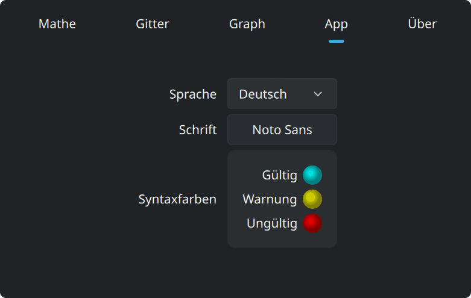

Hier stellst du die Sprache und Schriftart der Benutzeroberfläche sowie die
drei Farben der Eingabezeilen ein: gültig, Warnung und ungültig.

## 7. Der Reiter Über

Dieser Reiter enthält Informationen über ZeGrapher:

- die verwendete Version und einen Knopf, der auf zegrapher.com nach einer
  neueren Version sucht
- Links zur Website, zum Quellcode und zum Autor
- die Lizenzen von ZeGrapher, Qt und der mitgelieferten Mathematikschrift
- einen **Spenden**-Knopf, der die Spendenseite öffnet
- die Versionshinweise mit den Änderungen jeder Version und einem Link zur
  entsprechenden GitHub-Seite
